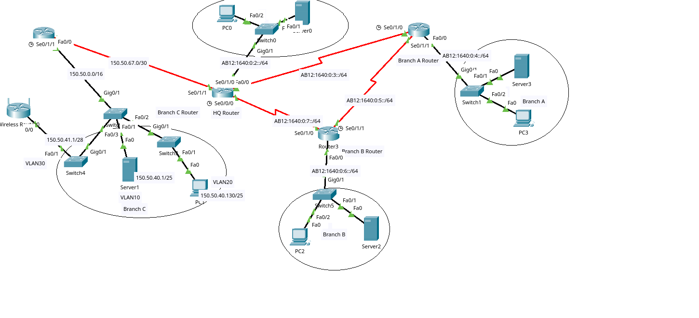

# Multi-Branch IPv4/IPv6 Network with VLAN Segmentation

## Overview

This Cisco Packet Tracer project models a headquarters and three branch locations connected through routed WAN links. It combines an IPv4 branch domain, an IPv6 headquarters/branch domain, VLAN segmentation, router-on-a-stick inter-VLAN routing, and separate OSPFv2/OSPFv3 routing processes.

The project was originally completed as university coursework and has been extracted and documented as a networking portfolio project. The repository preserves the original Packet Tracer simulation and the running configurations recovered from each Cisco router and switch.

> **Accuracy note:** This is better described as a mixed IPv4/IPv6 topology than a fully dual-stack network. Most configured interfaces and endpoints use either IPv4 or IPv6, rather than both protocols on the same interface.

## Verified Technical Features

- Headquarters plus Branch A, Branch B and Branch C
- 20 simulated devices and 19 physical/logical links
- Four Cisco 1841 routers and six Cisco 2960 switches
- IPv4 VLSM using `/25`, `/28` and `/30` networks
- IPv6 `/64` LAN and WAN prefixes
- OSPFv2 process 101, area 101, between HQ and Branch C
- OSPFv3 process 101, area 101, across HQ, Branch A and Branch B
- Router-on-a-stick inter-VLAN routing at Branch C
- IEEE 802.1Q trunk links
- VLAN 10, VLAN 20 and VLAN 30 segmentation
- Wired servers and PCs at each major site
- A wireless-router segment at Branch C
- IPv4/IPv6 translation-oriented commands at HQ, including `64:FF9B::/96` (requires correction and validation; see the audit)

## Logical Design

```text
                          IPv6 OSPFv3 area 101

                 +------------ Branch A ------------+
                 |          Router2 / Switch1        |
                 |                                   |
                 |                                   |
        HQ Router0 ----------------------------- Branch B Router3
        Switch0 / PCs             IPv6            Switch5 / PCs
             |
             | 150.50.67.0/30 — IPv4 OSPFv2 area 101
             |
        Branch C Router1
             |
             | 802.1Q router-on-a-stick
             |
          Switch2
          /   |   \
     VLAN10 VLAN20 VLAN30
     Server    PC   Wireless router
```

## Device Inventory

| Site | Packet Tracer devices | Function |
|---|---|---|
| Headquarters | Router0, Switch0, PC0, Server0 | IPv6 headquarters LAN and IPv4/IPv6 boundary router |
| Branch A | Router2, Switch1, PC3, Server3 | IPv6 branch LAN |
| Branch B | Router3, Switch5, PC2, Server2 | IPv6 branch LAN |
| Branch C | Router1, Switch2, Switch3, Switch4, PC1, Server1, Wireless Router0 | IPv4 branch with three VLANs |

## Repository Structure

```text
.
├── README.md
├── packet-tracer/
│   └── multi-branch-ipv4-ipv6-vlan-network.pkt
├── configs/
│   ├── hq-router_Router0.txt
│   ├── branch-a-router_Router2.txt
│   ├── branch-b-router_Router3.txt
│   ├── branch-c-router_Router1.txt
│   └── ...switch configurations...
├── docs/
│   ├── addressing-plan.md
│   ├── topology-links.md
│   ├── validation-plan.md
│   └── project-audit.md
└── topology/
    └── README.md
```

## How to Run the Simulation

1. Install Cisco Packet Tracer 8.2.2 or a compatible later version.
2. Download `packet-tracer/multi-branch-ipv4-ipv6-vlan-network.pkt`.
3. Open the file in Packet Tracer.
4. Allow the simulation to converge.
5. Use the checks in `docs/validation-plan.md` to verify VLANs, trunks, OSPF neighbours, routes and endpoint connectivity.

## What I Practised

- Translating logical requirements into a multi-site topology
- Subnetting IPv4 networks with different prefix lengths
- Allocating IPv6 `/64` prefixes
- Configuring VLAN access ports and trunks
- Implementing router-on-a-stick inter-VLAN routing
- Configuring OSPFv2 and OSPFv3 in a single area
- Connecting wired and wireless branch endpoints
- Reading and documenting Cisco IOS running configurations

## Current Status

The topology and configurations are present in the `.pkt` file, but a fresh end-to-end validation run should be captured before the project is described as fully operational. In particular, the IPv4-to-IPv6 translation configuration at HQ contains unresolved items documented in `docs/project-audit.md`.

## Planned Improvements

- Rename all routers and switches with descriptive IOS hostnames
- Correct and validate the IPv4/IPv6 translation configuration
- Capture OSPFv2 and OSPFv3 neighbour output
- Record IPv4 and IPv6 routing tables
- Add successful and intentionally blocked connectivity tests
- Add a complete, privacy-safe topology image
- Add an interface-level addressing table after live verification

## Network Topology


